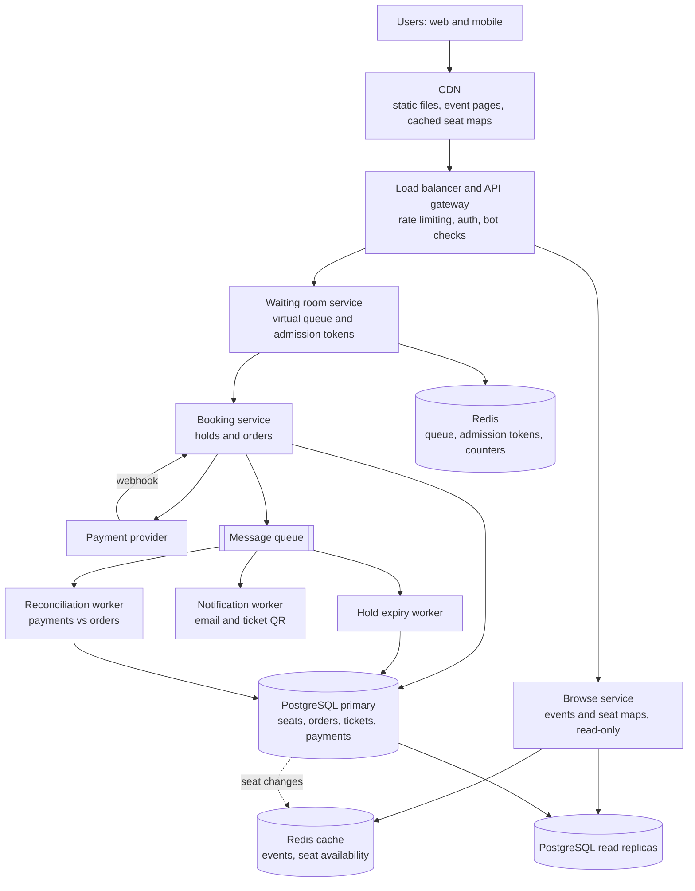

# TicketHub: System Design

TicketHub is a website that sells tickets for concerts and events. This document follows the six-part framework: requirements, estimates, API, data model, architecture, and trade-offs. It also explains how the design prevents two people from buying the same seat.

---

## 1. Requirements

### 1.1 Functional requirements

1. A user can register, log in, and manage their account.
2. A user can browse and search events by name, city, date, and category.
3. A user can open an event and see its seat map with the availability of each seat.
4. A user can select 1 to 4 seats and **hold** them for 5 minutes while they pay.
5. A user can pay for held seats and receive a confirmed order.
6. A user can view their tickets and past orders.
7. A user can release a hold, and unpaid holds release automatically when they expire.
8. For very popular events, a user joins a waiting room (virtual queue) before seat selection.

Out of scope: refunds and resale, organizer dashboards, recommendations.

### 1.2 Non-functional requirements

| Quality          | Requirement                                                                                                                                                                                                                                 | Why it matters                                                                                                                       |
| ---------------- | ------------------------------------------------------------------------------------------------------------------------------------------------------------------------------------------------------------------------------------------- | ------------------------------------------------------------------------------------------------------------------------------------ |
| **Speed**        | Browse and event pages: p95 under 300 ms. Seat map: p95 under 500 ms. Hold request: p95 under 500 ms, even during a big sale.                                                                                                               | People abandon slow pages. During a sale, seconds decide who gets a seat.                                                            |
| **Correctness**  | A seat is **never** sold to two people (zero double-booking). A user is never charged without receiving a ticket, and never receives a ticket without being charged. Payment retries never charge twice.                                    | A double-sold seat means an angry customer at the door and a refund. Money errors are the most damaging failure for a ticket seller. |
| **Fairness**     | Users admitted to buy are served in the order they arrived (first-come, first-served). One person cannot take a huge share (maximum 4 tickets per order, with a per-account limit per event). Bots are slowed with rate limits and CAPTCHA. | 200,000 people compete for 20,000 seats. Trust in the process is the product.                                                        |
| **Availability** | 99.9% normally. Browsing stays up even if booking is degraded.                                                                                                                                                                              | Browsing is the front door of the business.                                                                                          |
| **Scalability**  | Handle roughly 600 times normal traffic for short bursts without a rewrite.                                                                                                                                                                 | See the estimates below.                                                                                                             |
| **Durability**   | Orders, payments and tickets are never lost (replicated database, backups).                                                                                                                                                                 | These are financial records.                                                                                                         |
| **Security**     | HTTPS everywhere, hashed passwords, card data handled only by the payment provider (we store tokens, not card numbers).                                                                                                                     | Legal and trust requirement.                                                                                                         |

---

## 2. Estimates

### 2.1 Normal day

Given: 2,000,000 registered users, 50,000 visitors per day, 10 pages each, 5,000 tickets sold per day.

| Item                                                                                   | Calculation                     | Result                                           |
| -------------------------------------------------------------------------------------- | ------------------------------- | ------------------------------------------------ |
| Page views per day                                                                     | 50,000 x 10                     | **500,000**                                      |
| Average requests per second                                                            | 500,000 / 86,400 s              | **about 6 req/s**                                |
| Realistic busy-hour peak (assume traffic is about 10x the average at the busiest time) | 6 x 10                          | **about 60 req/s**                               |
| Tickets sold per day                                                                   | given                           | 5,000                                            |
| Average ticket sales per second                                                        | 5,000 / 86,400                  | **about 0.06 per second** (roughly 1 every 17 s) |
| Read-to-write ratio                                                                    | 500,000 views : 5,000 purchases | **about 100 : 1** (read-heavy)                   |

A normal day is very easy: one small database could handle this.

### 2.2 Big sale (one popular concert)

Given: 200,000 people try to buy 20,000 seats within the first 10 minutes (600 seconds).

Assumptions: each person makes about 10 requests during the sale (join the queue, poll status, load seat map a few times, try a hold, pay). Traffic is front-loaded: the first minute is about 3 times busier than the 10-minute average.

| Item                                        | Calculation                                            | Result                                                                                         |
| ------------------------------------------- | ------------------------------------------------------ | ---------------------------------------------------------------------------------------------- |
| Arrivals                                    | 200,000 / 600 s                                        | **about 333 new users per second** on average                                                  |
| Total requests                              | 200,000 x 10                                           | 2,000,000                                                                                      |
| Average requests per second                 | 2,000,000 / 600                                        | **about 3,300 req/s**                                                                          |
| Peak requests per second (first minute, 3x) | 3,300 x 3                                              | **about 10,000 req/s**                                                                         |
| Hold attempts (about 2 per user)            | 400,000 / 600                                          | about 670 per second on average, **about 2,000 per second at peak**                            |
| Competition per seat                        | 200,000 users / 20,000 seats                           | **10 people for every seat**; 90% of users will lose                                           |
| Maximum successful sales                    | 20,000 / 600 s                                         | **about 33 sales per second** at best                                                          |
| Seat-map payload                            | 20,000 seats if sent individually, about 30 bytes each | about 600 KB, too big; send section summaries and load a section's seats on demand, compressed |

### 2.3 Comparison

| Metric                      | Normal                                              | Big sale                     | Ratio                                    |
| --------------------------- | --------------------------------------------------- | ---------------------------- | ---------------------------------------- |
| Average requests per second | about 6                                             | about 3,300                  | **about 550x**                           |
| Peak requests per second    | about 60                                            | about 10,000                 | **about 170x**                           |
| Ticket sales per second     | 0.06                                                | up to 33                     | **about 550x**                           |
| Tickets sold                | 5,000 per day                                       | 20,000 in 10 minutes         | **4 normal days of sales in 10 minutes** |
| Load shape                  | smooth, spread over the day                         | sudden spike, then silence   |                                          |
| Contention                  | almost none (different people want different seats) | extreme (10 people per seat) |                                          |

**What this tells us:**

1. We cannot size the whole system for the sale. It would sit idle 99.9% of the time. We need elasticity (auto-scaling) plus a mechanism that **limits how much traffic reaches the booking core**: the virtual queue.
2. The danger is not raw volume (10,000 req/s is manageable for cached, stateless pages). The danger is **contention**: thousands of people fighting for the same 20,000 rows at the same moment. Correctness (no double-booking) must hold under that fight.
3. Most of the sale traffic is reads (refreshing the seat map). These can be served from cache or CDN. Only holds and payments need to touch the database.

---

## 3. API

REST over HTTPS, JSON bodies. All endpoints except browsing require a `Authorization: Bearer <token>` header. Money endpoints require an `Idempotency-Key` header so that a retry never charges twice.

### 3.1 Endpoints

| #   | Purpose                                    | Method and path                                 |
| --- | ------------------------------------------ | ----------------------------------------------- |
| 1   | Browse and search events                   | `GET /v1/events?city=&category=&from=&q=&page=` |
| 2   | Event details                              | `GET /v1/events/{eventId}`                      |
| 3   | View seats                                 | `GET /v1/events/{eventId}/seats?section=`       |
| 4   | Join the waiting room (popular events)     | `POST /v1/events/{eventId}/queue`               |
| 5   | Check queue position / get admission token | `GET /v1/events/{eventId}/queue/me`             |
| 6   | Hold seats                                 | `POST /v1/events/{eventId}/holds`               |
| 7   | Release a hold                             | `DELETE /v1/holds/{holdId}`                     |
| 8   | Pay for a hold (creates the order)         | `POST /v1/orders`                               |
| 9   | View one order                             | `GET /v1/orders/{orderId}`                      |
| 10  | View my tickets                            | `GET /v1/me/tickets`                            |
| 11  | Register / log in                          | `POST /v1/auth/register`, `POST /v1/auth/login` |

### 3.2 Key request and response examples

**1. Browse events**

```http
GET /v1/events?city=Nairobi&category=concert&page=1
200 OK
{
  "items": [
    { "eventId": "evt_901", "name": "Sauti Live", "venue": "Kasarani Stadium",
      "startsAt": "2026-12-05T18:00:00Z", "minPrice": 2500, "status": "ON_SALE" }
  ],
  "nextPage": 2
}
```

**3. View seats** (served from cache, a few seconds old at most)

```http
GET /v1/events/evt_901/seats?section=A
200 OK
{
  "section": "A",
  "seats": [
    { "seatId": "A-1-12", "row": "1", "number": 12, "price": 5000, "status": "AVAILABLE" },
    { "seatId": "A-1-13", "row": "1", "number": 13, "price": 5000, "status": "HELD" },
    { "seatId": "A-1-14", "row": "1", "number": 14, "price": 5000, "status": "SOLD" }
  ],
  "asOf": "2026-12-01T10:00:03Z"
}
```

The status shown is a hint only. The real decision is made at hold time.

**6. Hold seats**

```http
POST /v1/events/evt_901/holds
Authorization: Bearer <token>
X-Admission-Token: <token from queue>       (required for queued events)
{ "seatIds": ["A-1-12", "A-1-13"] }

201 Created
{ "holdId": "hld_77", "seatIds": ["A-1-12", "A-1-13"],
  "expiresAt": "2026-12-01T10:05:03Z", "totalPrice": 10000 }

409 Conflict
{ "error": "SEAT_UNAVAILABLE", "unavailableSeatIds": ["A-1-13"] }
```

Holding is all-or-nothing: if any one seat is taken, none are held.

**8. Pay**

```http
POST /v1/orders
Authorization: Bearer <token>
Idempotency-Key: 5f1c-...-9a
{ "holdId": "hld_77", "paymentMethodToken": "tok_abc" }

201 Created
{ "orderId": "ord_5512", "status": "PAID",
  "tickets": [ { "ticketId": "tkt_1", "seatId": "A-1-12" },
               { "ticketId": "tkt_2", "seatId": "A-1-13" } ] }

410 Gone     { "error": "HOLD_EXPIRED" }
402 Payment Required   { "error": "PAYMENT_DECLINED" }
```

**10. My tickets**

```http
GET /v1/me/tickets
200 OK
{ "tickets": [ { "ticketId": "tkt_1", "eventName": "Sauti Live",
                 "startsAt": "2026-12-05T18:00:00Z", "seat": "A-1-12",
                 "qrCode": "..." } ] }
```

### 3.3 API design notes

- **Idempotency-Key on holds and orders:** if the network drops and the client retries, the server returns the original result instead of creating a second hold or charge.
- **Pagination** on every list endpoint, so no response is unbounded.
- **Rate limiting** per user and per IP, much stricter on hold and order endpoints.
- **409 vs 410 vs 402** give the client clear, different next steps: pick other seats, restart, or fix payment.

---

## 4. Data model

Relational database (PostgreSQL). Relational is chosen because correctness matters more than anything here, and we need transactions and constraints.

### 4.1 Tables

```sql
CREATE TABLE users (
  user_id        BIGINT PRIMARY KEY,
  email          TEXT NOT NULL UNIQUE,
  password_hash  TEXT NOT NULL,
  name           TEXT NOT NULL,
  created_at     TIMESTAMPTZ NOT NULL DEFAULT now()
);

CREATE TABLE venues (
  venue_id  BIGINT PRIMARY KEY,
  name      TEXT NOT NULL,
  city      TEXT NOT NULL,
  capacity  INT  NOT NULL
);

CREATE TABLE events (
  event_id    BIGINT PRIMARY KEY,
  venue_id    BIGINT NOT NULL REFERENCES venues(venue_id),
  name        TEXT NOT NULL,
  category    TEXT NOT NULL,
  starts_at   TIMESTAMPTZ NOT NULL,
  sale_opens_at TIMESTAMPTZ NOT NULL,
  status      TEXT NOT NULL CHECK (status IN ('DRAFT','ON_SALE','SOLD_OUT','CANCELLED','ENDED'))
);
CREATE INDEX idx_events_city_date ON events (starts_at);

-- One row per seat PER EVENT. This is the inventory we protect.
CREATE TABLE seats (
  event_id          BIGINT NOT NULL REFERENCES events(event_id),
  seat_id           TEXT   NOT NULL,           -- e.g. 'A-1-12'
  section           TEXT   NOT NULL,
  price             INT    NOT NULL CHECK (price >= 0),
  status            TEXT   NOT NULL DEFAULT 'AVAILABLE'
                    CHECK (status IN ('AVAILABLE','HELD','SOLD')),
  held_by_user_id   BIGINT REFERENCES users(user_id),
  hold_id           UUID,
  hold_expires_at   TIMESTAMPTZ,
  version           INT NOT NULL DEFAULT 0,
  PRIMARY KEY (event_id, seat_id),
  -- A HELD seat must say who holds it and until when; others must not.
  CHECK ( (status = 'HELD') = (hold_id IS NOT NULL AND hold_expires_at IS NOT NULL) )
);
CREATE INDEX idx_seats_event_section_status ON seats (event_id, section, status);
CREATE INDEX idx_seats_expiring ON seats (hold_expires_at) WHERE status = 'HELD';

CREATE TABLE orders (
  order_id          BIGINT PRIMARY KEY,
  user_id           BIGINT NOT NULL REFERENCES users(user_id),
  event_id          BIGINT NOT NULL REFERENCES events(event_id),
  hold_id           UUID   NOT NULL UNIQUE,     -- one order per hold
  idempotency_key   TEXT   NOT NULL,
  total_amount      INT    NOT NULL,
  status            TEXT   NOT NULL CHECK (status IN ('PENDING','PAID','FAILED','REFUNDED')),
  created_at        TIMESTAMPTZ NOT NULL DEFAULT now(),
  UNIQUE (user_id, idempotency_key)
);

CREATE TABLE tickets (
  ticket_id   BIGINT PRIMARY KEY,
  order_id    BIGINT NOT NULL REFERENCES orders(order_id),
  event_id    BIGINT NOT NULL,
  seat_id     TEXT   NOT NULL,
  user_id     BIGINT NOT NULL REFERENCES users(user_id),
  qr_code     TEXT   NOT NULL UNIQUE,
  FOREIGN KEY (event_id, seat_id) REFERENCES seats (event_id, seat_id),
  -- THE SAFETY NET: a seat can appear on at most one ticket, ever.
  UNIQUE (event_id, seat_id)
);

CREATE TABLE payments (
  payment_id        BIGINT PRIMARY KEY,
  order_id          BIGINT NOT NULL REFERENCES orders(order_id),
  provider_ref      TEXT UNIQUE,
  amount            INT NOT NULL,
  status            TEXT NOT NULL CHECK (status IN ('PENDING','SUCCEEDED','FAILED','REFUNDED')),
  created_at        TIMESTAMPTZ NOT NULL DEFAULT now()
);
```

### 4.2 Relationships

- `venues` 1 --- many `events` (a venue hosts many events).
- `events` 1 --- many `seats` (each event has its own seat inventory, so prices and status are per event).
- `users` 1 --- many `orders` (a user places many orders).
- `events` 1 --- many `orders`.
- `orders` 1 --- many `tickets` (one order can buy up to 4 seats).
- `seats` 1 --- 0..1 `tickets` (a seat has at most one ticket, enforced by `UNIQUE (event_id, seat_id)`).
- `orders` 1 --- many `payments` (a failed attempt followed by a successful one).

### 4.3 Partitioning and growth

- `seats` is partitioned by `event_id`. A big sale hammers one event's partition, not the whole table.
- 20,000 seats per big event is a tiny table. Orders grow at about 5,000 per day (about 1.8 million per year), which is easy for one primary database.

---

## 5. How double-booking is prevented

The goal: **under any interleaving of requests, a seat ends up with at most one buyer.** We do not rely on the UI (which may show stale data) or on application code "checking first". The database enforces it, using three layers.

### Layer 1: Atomic conditional update (the main defence)

Holding is a single `UPDATE` that checks and changes the status in one atomic step, so there is no gap between "check" and "act":

```sql
BEGIN;

UPDATE seats
SET    status = 'HELD',
       held_by_user_id = :user_id,
       hold_id = :hold_id,
       hold_expires_at = now() + interval '5 minutes',
       version = version + 1
WHERE  event_id = :event_id
  AND  seat_id IN (:seat_ids)                 -- sorted order
  AND  ( status = 'AVAILABLE'
         OR (status = 'HELD' AND hold_expires_at < now()) );   -- expired holds are reusable

-- If rows affected != number of seats requested, at least one seat was
-- taken by someone else: ROLLBACK and return 409. Otherwise COMMIT.
COMMIT;
```

How it works: when two people try to hold seat A-1-12 at the same moment, PostgreSQL takes a **row lock** on the seat for the first `UPDATE`. The second `UPDATE` waits, then re-evaluates the `WHERE` clause on the _new_ row version. The status is now `HELD`, the condition fails, and it updates 0 rows. The loser gets `409 SEAT_UNAVAILABLE`. There is no way for both to succeed, because "check" and "set" are the same operation.

### Layer 2: Transaction for all-or-nothing

Seats for one hold are updated inside a single transaction. If one of two seats is unavailable, the transaction rolls back and the user does not end up holding half of what they wanted. Seat ids are always locked in **sorted order**, so two users who each want seats A-1-12 and A-1-13 cannot deadlock by locking them in opposite order.

### Layer 3: Constraints as a safety net

Even if a bug in the application slips through, the database refuses to store a double sale:

- `tickets` has `UNIQUE (event_id, seat_id)`: a second ticket for the same seat fails with a constraint violation and the whole transaction rolls back.
- `seats` has a `CHECK` that ties `HELD` to a holder and expiry time, and a `CHECK` limiting `status` to three values.
- `orders.hold_id` is `UNIQUE` and `(user_id, idempotency_key)` is `UNIQUE`: one hold cannot create two orders, and a retried payment request cannot create two charges.

### Confirming the purchase (hold to sold)

Payment happens outside the database (with the payment provider), so we must be careful about what happens between "hold" and "paid":

1. The order request carries `holdId`. The server first calls the payment provider with the idempotency key. The provider charges the card once even if we retry.
2. On success, one transaction runs:

```sql
BEGIN;
UPDATE seats SET status = 'SOLD', hold_id = NULL, hold_expires_at = NULL
WHERE  event_id = :e AND seat_id IN (:seat_ids)
  AND  status = 'HELD' AND hold_id = :hold_id AND held_by_user_id = :user_id;
-- rows affected must equal number of seats, else ROLLBACK and refund
INSERT INTO orders  (...) VALUES (... 'PAID');
INSERT INTO tickets (...) VALUES (...);          -- UNIQUE (event_id, seat_id) as a backstop
INSERT INTO payments (...) VALUES (... 'SUCCEEDED');
COMMIT;
```

3. The `WHERE hold_id = :hold_id` clause means only the holder can convert the hold to a sale. If the hold expired and someone else grabbed the seat during a slow payment, the update affects 0 rows, the transaction rolls back, and the payment is **automatically refunded**. To make that rare, the hold is 5 minutes and the payment step is given a short grace extension once it starts.

### Edge cases

| Situation                                                        | What happens                                                                                                                                                                             |
| ---------------------------------------------------------------- | ---------------------------------------------------------------------------------------------------------------------------------------------------------------------------------------- |
| Two users click the same seat at the same time                   | Row lock plus conditional update: exactly one wins, the other gets 409.                                                                                                                  |
| User abandons the page                                           | Hold expires after 5 minutes. A background worker also resets expired `HELD` rows to `AVAILABLE`, and the `WHERE` clause lets new buyers take expired holds even before the worker runs. |
| User double-clicks "Pay" or the network retries                  | Same `Idempotency-Key`: second call returns the first result, with no double charge.                                                                                                     |
| Payment succeeds but our server crashes before writing the order | The provider's webhook plus the `payments` row (keyed by `provider_ref`) lets a reconciliation job finish the order or refund.                                                           |
| Application bug tries to sell a sold seat                        | `UNIQUE (event_id, seat_id)` on `tickets` rejects it.                                                                                                                                    |
| Stale seat map shows a seat as available                         | Harmless: the click turns into a hold attempt, which fails with 409 and the UI refreshes.                                                                                                |

**Redis is deliberately not the source of truth.** Cached availability is only a hint for display. The PostgreSQL row is the only authority on who owns a seat.

---

## 6. Architecture

### 6.1 Diagram



### 6.2 Components

| Component                         | What it does                                                                                                                                                                                                                                                                                                                  | Why it is there                                                                                                                                        |
| --------------------------------- | ----------------------------------------------------------------------------------------------------------------------------------------------------------------------------------------------------------------------------------------------------------------------------------------------------------------------------- | ------------------------------------------------------------------------------------------------------------------------------------------------------ |
| **CDN**                           | Serves static assets, event listing pages and compressed seat maps (cached for a few seconds).                                                                                                                                                                                                                                | Takes the majority of the 10,000 req/s peak away from our servers. Reads are about 99% of sale traffic.                                                |
| **Load balancer and API gateway** | Spreads traffic over servers, checks authentication, applies per-user and per-IP rate limits, blocks bots (CAPTCHA).                                                                                                                                                                                                          | Fairness (stops one user or script flooding) and protection against overload.                                                                          |
| **Waiting room service**          | When a popular event opens, users join a virtual queue. They are admitted in arrival order (with a small random shuffle within the first seconds so network speed does not decide the winner) at a controlled rate, for example 500 per second. Admission produces a signed, short-lived token required by the hold endpoint. | The key to surviving the sale: **the booking core only ever sees a rate it can handle**, not 200,000 people at once. Also the main fairness mechanism. |
| **Browse service**                | Stateless, read-only service for events, event details and seat maps.                                                                                                                                                                                                                                                         | Scales horizontally. Reads can be served from cache or replicas, and it keeps working even if booking is struggling.                                   |
| **Redis cache**                   | Caches event data and per-section seat availability for a few seconds.                                                                                                                                                                                                                                                        | Fast reads (speed requirement) and protects the database. Stale data is acceptable here because holds are verified by the database.                    |
| **Redis (queue state)**           | Stores queue positions, admission tokens and per-user counters.                                                                                                                                                                                                                                                               | Fast, in-memory counters for the waiting room. If lost, the queue can be rebuilt. No financial data lives here.                                        |
| **Booking service**               | Stateless service that runs the hold and order transactions from section 5.                                                                                                                                                                                                                                                   | The only code that writes seat state. Keeping it small and strict makes correctness easier to reason about.                                            |
| **PostgreSQL primary**            | Source of truth for seats, orders, tickets and payments, with transactions and constraints.                                                                                                                                                                                                                                   | Correctness. It guarantees no double-booking.                                                                                                          |
| **Read replicas**                 | Copies of the database for read queries.                                                                                                                                                                                                                                                                                      | Offloads reads from the primary. Replication lag is acceptable for browsing only.                                                                      |
| **Payment provider**              | External service that charges cards and sends a webhook with the result.                                                                                                                                                                                                                                                      | We never store card numbers. Idempotency keys prevent double charges.                                                                                  |
| **Message queue**                 | Carries asynchronous jobs.                                                                                                                                                                                                                                                                                                    | Slow work (emails, reconciliation) is kept out of the purchase path, so purchases stay fast.                                                           |
| **Workers**                       | _Hold expiry:_ releases expired holds. _Notification:_ sends confirmation emails and tickets. _Reconciliation:_ compares provider payments to orders and fixes mismatches (completes the order or refunds).                                                                                                                   | Reliability and correctness without slowing users.                                                                                                     |

### 6.3 How the system survives the big sale

1. **Before the sale:** the popular event is flagged "queued". Auto-scaling adds browse and booking servers ahead of the scheduled start time (we know the time in advance). The event page and seat sections are pre-warmed in the cache.
2. **Absorb the spike at the edge:** the CDN and cache answer most of the roughly 10,000 req/s, since most are page loads and refreshes. The rate limiter and CAPTCHA drop bot traffic.
3. **Flatten the spike with the queue:** 200,000 users enter the waiting room (about 333 per second, a cheap operation in Redis). Only a limited number are admitted at a time (for example 500 per second, with a cap on concurrent shoppers). The booking service and database see at most a couple of thousand hold attempts per second, the load we estimated they can handle.
4. **Make contention cheap:** each hold is a short, indexed, per-row transaction on one event's partition, finishing in milliseconds. The seat map is split by section so users pick different areas and spread out the contention. Losing a seat returns 409 right away, so failures are fast and do not pile up.
5. **Keep the core separate:** browsing is a separate service and uses replicas and cache, so even if booking slows down, other events remain browsable and buyable.
6. **Protect correctness under load:** if the system gets overloaded it slows the queue admission rate (it **sheds load** at the front) instead of letting requests reach the database in an uncontrolled way. It is better to make people wait than to risk wrong data.
7. **Sold out:** when the last seat is sold, the event status changes to `SOLD_OUT`, the cache is updated, and everyone in the queue is told right away. This stops 180,000 people from sending pointless requests.
8. **After the sale:** auto-scaling shrinks back, and the expiry worker returns abandoned holds to the pool, which gives a second chance to people who stayed.

### 6.4 Failure handling summary

| Failure                            | Result                                                                                                                                    |
| ---------------------------------- | ----------------------------------------------------------------------------------------------------------------------------------------- |
| Booking server crashes mid-request | The transaction rolls back. The hold or order either fully exists or does not. The client retries with the same idempotency key.          |
| Redis goes down                    | Browsing is slower (reads fall back to replicas), the queue pauses and recovers. Seats remain safe because the database is the authority. |
| Replica lags                       | Users may briefly see a stale seat map. A hold attempt still gets the correct answer from the primary.                                    |
| Payment provider is slow or down   | Holds keep their timer. Users see "payment pending" and the reconciliation worker resolves the result.                                    |
| Primary database fails             | Automatic failover to a synchronous standby (no committed order lost). Booking is briefly unavailable while browsing continues.           |

---

## 7. Trade-offs

### Trade-off 1: Strong consistency (SQL transactions) vs. raw throughput and horizontal scale

- **Choice:** Use PostgreSQL with row locks and constraints for seats, orders and tickets, instead of an eventually consistent NoSQL store that scales more easily.
- **Gain:** Strong guarantees: no double-booking, no payment without ticket. The logic is simple to reason about and test.
- **Cost:** Writes go to a single primary per data set, which limits write scale and makes the primary a bottleneck.
- **Why it is acceptable:** Our worst-case write rate (about 2,000 holds per second, about 33 sales per second) is well within what one tuned primary can do, especially with seats partitioned by event. Because the queue limits what reaches it, we do not need to give up correctness for scale. If we ever outgrow it, we can shard by `event_id`.

### Trade-off 2: Virtual queue (fairness and stability) vs. user experience and simplicity

- **Choice:** Put users in a waiting room and admit them at a controlled rate.
- **Gain:** Protects the database, gives a fair first-come-first-served order, and reduces the benefit of bots and constant refreshing.
- **Cost:** Extra complexity (another service and more state), and users wait, which many dislike. Some people will leave when told they are number 90,000 in line.
- **Why it is acceptable:** Without it, the likely result is a crash or a free-for-all won by the fastest connection or bot. We show honest position and estimated wait to keep trust. Only popular events use the queue, so normal sales are not affected.

### Trade-off 3: Stale cached seat maps vs. database load

- **Choice:** Show seat availability from a cache that is a few seconds old instead of querying the primary each time.
- **Gain:** Fast pages (speed requirement) and a huge reduction in database reads.
- **Cost:** Users sometimes click a seat that was just taken and get a 409.
- **Why it is acceptable:** The cache is only advisory; the hold transaction is authoritative. A clear message plus an automatic refresh makes this a small annoyance, not a correctness problem.

### Trade-off 4: Hold duration (5 minutes) vs. seat utilization

- **Choice:** Hold seats for 5 minutes while the user pays.
- **Gain:** Users can pay without losing the seat, and it avoids charging someone for a seat that was sold to someone else.
- **Cost:** Seats of people who abandon the page are unavailable for up to 5 minutes, which hurts others during a sale and can make the event look sold out when it is not.
- **Why it is acceptable:** The timer is short, expired seats are reusable immediately, and holds released at expiry give people in the queue a second chance. The duration can be tuned per event (for example 3 minutes for very popular events).

---

## 8. Summary

| Framework part | Key decision                                                                                                                            |
| -------------- | --------------------------------------------------------------------------------------------------------------------------------------- |
| Requirements   | Speed, correctness (no double-booking) and fairness drive the design.                                                                   |
| Estimates      | Normal: about 6 req/s. Big sale: about 3,300 req/s average, 10,000 at peak, about 550x normal, with 10 people per seat.                 |
| API            | 11 endpoints, with holds as a separate step from payment, and idempotency keys on money operations.                                     |
| Data model     | `users`, `venues`, `events`, `seats`, `orders`, `tickets`, `payments`; `UNIQUE (event_id, seat_id)` on tickets is the final safety net. |
| Double-booking | Atomic conditional update plus transactions plus constraints.                                                                           |
| Architecture   | CDN, cache, waiting room, stateless services, PostgreSQL primary with replicas, async workers.                                          |
| Trade-offs     | Consistency over scale, queue fairness over convenience, cache staleness for speed, hold time vs. utilization.                          |
